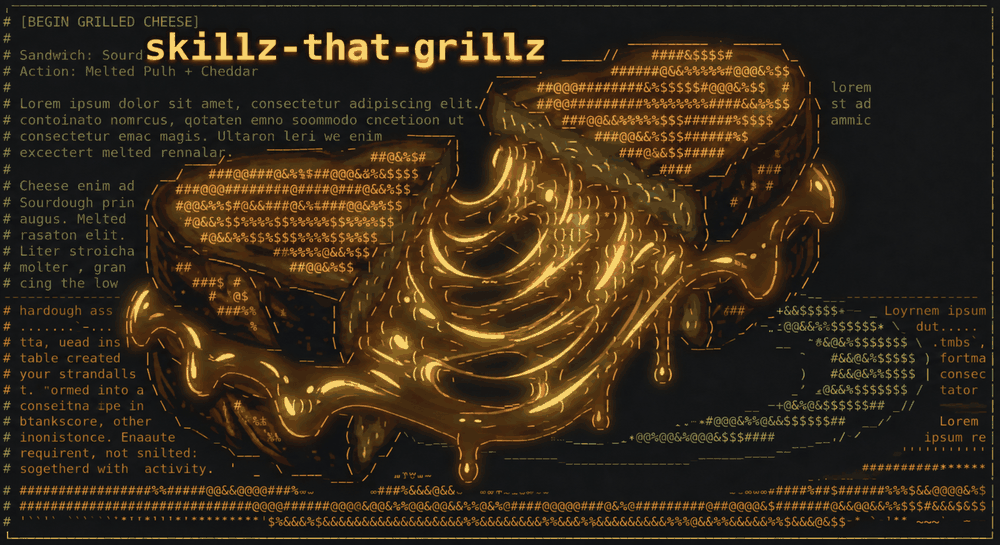

# 

[](https://github.com/paulnsorensen/skillz-that-grillz/actions/workflows/validate.yml)
[](LICENSE)
[](https://github.com/paulnsorensen/skillz-that-grillz/releases/latest)
[](https://skills.sh/paulnsorensen/skillz-that-grillz)
[](https://www.conventionalcommits.org)
[](https://github.com/paulnsorensen/skillz-that-grillz/pulls)

> _`/skillz` audits, improves, and packages Agent Skills so they run the same way on every harness._

## Why

An Agent Skill is a prompt that you ship. It can fail in quiet ways.
`/skillz` checks the failures that you can verify:

- **Skills trigger unpredictably.** The Invocation lens checks that the
  `description` holds trigger phrases and anti-triggers, front-loaded.
- **Skills drift across harnesses.** The Portability lens checks the
  frontmatter against a cross-harness matrix for Claude Code, Codex, OMP, and
  other Agent Skills hosts.
- **Skills repeat fixed work.** The Deterministic offload lens finds parsing,
  counting, and filtering that the model re-derives on every run. `wedge`
  moves that work into a tested CLI.
- **Nobody knows if an edit helped.** `autoimprove` compares candidate edits
  on paired holdouts and exports a private patch. The Usage lens compares what
  a skill declares with what your session logs show it does.
- **Findings come without a confidence level.** Every finding carries a
  severity and a confidence. `audit` never changes your target.

## Quick start

Install the skill with the [skills.sh](https://skills.sh) installer:

```sh
npx skills@latest add paulnsorensen/skillz-that-grillz --skill skillz
```

Add `--global` to install user-wide. Without it, the skill installs into the
current repo under `.agents/skills/`. The installer reads the default branch,
`dist`, which holds the built `scripts/*.pyz` archives. Any other installer
must also follow the remote default branch. A cache that stays on `main`, and a
release tag on a `main` commit, have no archives
([distribution contract](skills/skillz/references/wedge-packaging.md#distribution-contract-for-direct-mode-on-a-dist-branch)).
Then run the skill in your agent harness:

```text
/skillz audit skills/my-skill/SKILL.md       # report only; never edits the target
/skillz improve skills/my-skill/SKILL.md     # shows every finding, then asks what to apply
/skillz wedge skills/my-skill/SKILL.md       # move repeated work into a tested CLI
/skillz autoimprove skills/my-skill          # compare candidate edits on paired holdouts
```

`/skillz` is user-only. A phrase such as "audit this skill" does not invoke it.
Type the command.

### What an audit looks like

This trimmed example shows the report format. The skill name and findings are
illustrative.

```markdown
## skillz audit: release-notes

- Type: skill · Invocation: user-only · Body: ~1.8k tok
- Harnesses reached: Claude Code, Codex · Findings: 2 surfaced, 1 below the bar
- Target: skills/release-notes/SKILL.md · Usage: included

| # | Severity | Confidence | Lens | Issue (line) | Fix | Recommendation |
|---|---|---|---|---|---|---|
| 1 | high | certain | Invocation | description summarizes the workflow (L3) | List trigger phrases and anti-triggers | apply |
| 2 | medium | certain | Deterministic offload | step 4 re-sorts commits on every run (L41) | Move the sort into a CLI | /skillz wedge |

Run /skillz improve skills/release-notes/SKILL.md to apply.
```

## Modes

| Mode | What it does |
| --- | --- |
| `add <name>` | Creates a new skill that passes the rubric, with trigger and task evals. |
| `improve <path>` | Reuses or runs an audit, shows every finding, and applies only the ones that you approve. Also accepts `optimize` and `tighten`. |
| `audit <path>` | Scores a skill or sub-agent file against the rubric and reports calibrated findings. It never modifies the target. |
| `wedge <path>` | Finds fixed computation, writes a behavior contract for each candidate, and builds the ones that you select as `fromargs` CLIs. |
| `autoimprove <path>` | Compares candidate edits on paired holdouts through isolated harness runs. Exports a private patch. Also accepts `experiment`. |

## Requirements

- Python 3.11+ for the bundled helpers.
- A writable cache root for the bundled helpers: `SHIV_ROOT`, else
  `XDG_CACHE_HOME/shiv`, else `~/.cache/shiv`. In an agent sandbox, allow
  writes there. See the
  [runtime contract](skills/skillz/references/wedge-packaging.md#runtime-contract).
- [uv](https://docs.astral.sh/uv/) on `PATH` to wedge a CLI. Without uv,
  `skillz wedge` falls back to a stdlib `argparse` CLI or a shell pipeline.
- Optional: the `duckdb` CLI for the Usage lens. Without it, `skillz` offers a
  slower sampled scan of raw logs, only with your consent. You can skip Usage.
  The session cache comes from
  [`agent-session-analytics`](packages/agent-session-analytics/README.md).
- Optional: Codex, Claude Code, or a configured trusted harness wrapper for
  `autoimprove`. See [the autoimprove workflow](skills/skillz/references/experiments.md).

No MCP server and no source checkout are needed.

## Skills

| Skill path | Command | Purpose |
| --- | --- | --- |
| `skills/skillz/SKILL.md` | `/skillz` | Add, improve, audit, wedge, or autoimprove a skill or sub-agent definition. It scores the target against 13 core lenses plus an optional Usage lens, so it runs predictably on Claude Code, Codex, OMP, and other Agent Skills hosts. |

This repo no longer publishes other skills. See the [changelog](CHANGELOG.md#unreleased) for where they went.

## Also in this repo

- **`wedge`** packages a `fromargs` CLI as a content-addressed `.pyz` for a
  skill. It is not on PyPI. Run it from git, for example
  `uvx --from 'git+https://github.com/paulnsorensen/skillz-that-grillz#subdirectory=packages/wedge' wedge bundle --root skills`.
  See [`packages/wedge/README.md`](packages/wedge/README.md).
- **[`actions/wedge`](actions/wedge/README.md)** runs `wedge` in your repository.
  It checks locks on pull requests and merge groups, then publishes assets
  after a merge. See the
  [merge-queue setup](actions/wedge/README.md#check-pull-requests-and-merge-groups).

  ```yaml
  - uses: paulnsorensen/skillz-that-grillz/actions/wedge@<full-commit-sha>
    with:
      command: publish # or: check
      roots: skills
  ```

- **[`fromargs`](https://pypi.org/project/fromargs/)** is the self-healing
  Cyclopts CLI library that `wedge` builds on. Install it with
  `pip install fromargs`. See [`packages/fromargs/README.md`](packages/fromargs/README.md).
- **[`agent-session-analytics`](https://pypi.org/project/agent-session-analytics/)**
  ingests coding-agent session logs into DuckDB and queries them read-only.
  Install it with `uv tool install agent-session-analytics`. See
  [`packages/agent-session-analytics/README.md`](packages/agent-session-analytics/README.md).

Each package keeps its own changelog next to its README. The root
[`CHANGELOG.md`](CHANGELOG.md) covers the `skillz` skill and the repo.

## Related

- [easy-cheese](https://github.com/paulnsorensen/easy-cheese) covers the design,
  implement, and review workflow (mold, cook, press, age, cure). Its `/plate`
  handles staging, commits, pushes, and PR creation.
- [git-gouda](https://github.com/paulnsorensen/git-gouda) holds the repository
  setup and maintenance skills that used to live here.

## Contributing

```sh
git clone https://github.com/paulnsorensen/skillz-that-grillz.git
cd skillz-that-grillz
just build   # runs all formatters, linters, and test suites
```

See [`CONTRIBUTING.md`](CONTRIBUTING.md). Open pull requests against `main`.
The default branch is `dist`, which CI writes after each merge.
For the design notes behind the code, see the [docs guide](docs/README.md).

## License

MIT. See [LICENSE](LICENSE).
